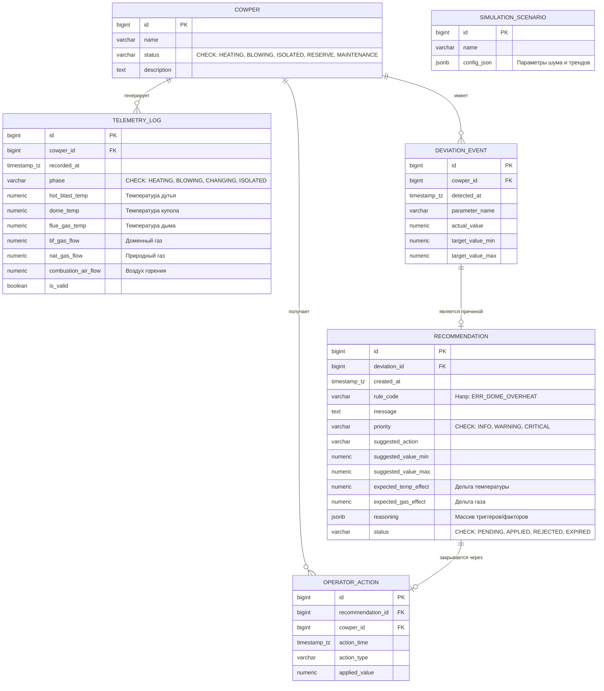

# ER-диаграмма базы данных (Entity-Relationship)

В данном документе представлена логическая структура реляционной базы данных (PostgreSQL) для проекта «Интеллектуальная система рекомендаций по управлению воздухонагревателями». 

Схема разработана с учетом разделения на time-series данные (телеметрия), доменные сущности (кауперы) и бизнес-логику (отклонения, рекомендации и действия оператора).

